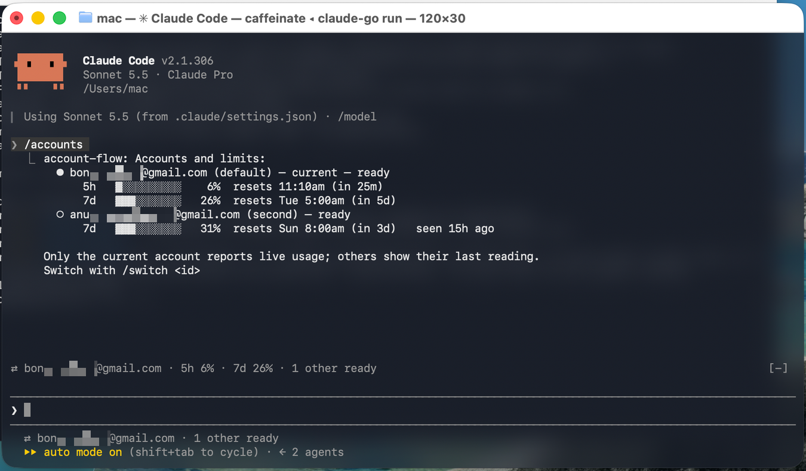
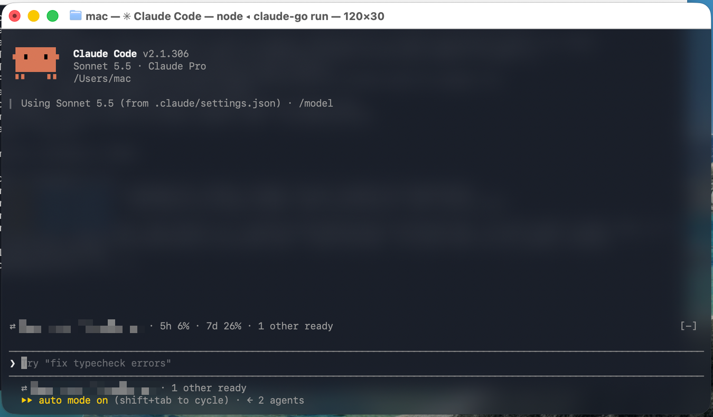
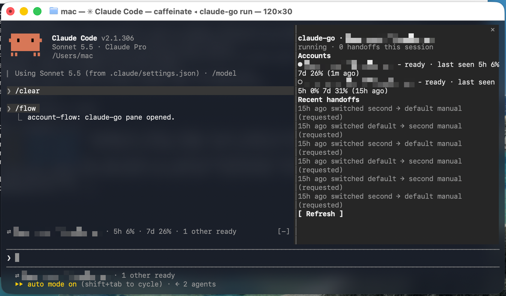

# claude-go

use several claude code accounts as one. when the account you are on hits its usage limit, claude-go
stops claude, starts it again on another account with `--resume <the same session>`, and tells you in
one line. written in go, stdlib only. no tokens ever pass through it.

not a proxy, not a credential manager. every account signs in through the real `claude auth login`
and claude-go only decides which one runs.

## install

```
curl -fsSL https://raw.githubusercontent.com/Svector-anu/claude-go/main/install.sh | sh
```

macos and linux, no sudo. it checks the download's sha-256 before installing to `~/.local/bin`. with go
1.26 you can use `go install github.com/Svector-anu/claude-go/cmd/claude-go@latest` instead. then:

```
claude-go setup                          # once
claude-go accounts add personal --login  # once per extra account (opens a browser)
claude                                   # every day (if you accepted the shortcut)
```

when an account runs out you see one line, then keep working:

```
account work@example.com hit its limit, continuing on account me@example.com
```

## what it looks like

`/accounts` lists every account with its limits. only the account you are on reports live usage, the
others show their last reading and how old it is.



the indicator above the prompt shows the live account, its 5h and 7d windows, and how many others are
ready.



`/flow pane` opens a side panel with the accounts and the recent handoffs. it needs a wide terminal
(about 144 columns).



## how it works

- **isolation.** each extra account has its own `CLAUDE_CONFIG_DIR` under `~/.claude-go/profiles/<name>`
  and signs in through the real `claude auth login`. your current login stays at `~/.claude` and is
  registered as `default` without copying anything. claude-go never reads or stores a credential.
- **one conversation history.** profiles link `projects/` and your settings, skills, commands and
  `CLAUDE.md` to the ones in `~/.claude`, so every account sees the same sessions and the same hook.
  your onboarding and trusted folders are carried over too, so a new account does not open with
  first-run screens that would block a handoff.
- **detection.** two independent signals, neither needing the other. (1) claude writes a structured
  `quotaLimits` record (which window, exact reset time) at the end of the session's transcript when a
  limit stops a turn. claude-go reads the tail of that file, so no message wording is parsed. (2) a
  `StopFailure` hook (installed by `setup`, never touching other hooks) reports api failures. only a real
  usage limit moves an account out of rotation. overloads, retryable 429s and bad requests do not.
  anything recorded before the current process started is ignored, so a handoff can never be re-triggered
  by the old account's limit.
- **handoff.** the go controller stops claude (SIGTERM, then SIGKILL after 5 s), waits for it to exit,
  and starts `claude --resume <id>` under the next eligible account. it reports success only after the
  replacement process has started, and restarts the original account if it cannot.
- **picking up the interrupted request.** when a verified usage limit cut a request short, the resumed
  session also gets one short message (`[claude-go] Continuing after an account switch…`), so claude
  carries on without you retyping. only automatic, confirmed limit switches do this. never a manual
  `/switch`, a sign-in failure, or a transcript that does not end at a limit. turn it off or reword it in
  `~/.claude-go/config.json`: `{"version":1,"continue_after_limit":false}` or `"continue_message":"…"`.
- **when nothing is left** the session keeps running (claude's own wait applies) and one line at exit
  names the earliest reset time.

## commands

| | |
|---|---|
| `claude-go setup [--yes] [--statusline] [--mod] [--undo]` | one-time setup. `--undo` removes the hook, status-line segment, mod and shell block (accounts and profiles stay) |
| `claude-go run [--account ID] [claude args]` | start claude under an account |
| `claude-go accounts list \| add ID [--login] \| login ID \| enable ID \| remove ID [--purge-profile]` | manage accounts |
| `claude-go handoff ACCOUNT` | move a running session now |
| `claude-go history [-n N]` / `status` | recent handoffs. configuration and state |

inside claude: `/accounts`, `/switch <id>`, `/flow [status|history|pane]`.

## optional project memory

`claude-go setup --memory` lets claude save and recall short project notes (decisions, conventions, how
things are set up) that survive account switches and can follow you between machines. local files only, no
network, secrets refused. see [docs/MEMORY.md](docs/MEMORY.md).

## optional claude code integration

`claude-go setup --mod` installs a small mod that adds `/accounts`, `/switch <id>`, `/flow`, the indicator
above the prompt and a toast after a handoff. `claude-go setup --statusline` adds a segment to your status
line, wrapping an existing one rather than replacing it. both are optional, reversible, and the core works
without them. see [docs/MOD.md](docs/MOD.md).

## build and test

```
make build      # bin/claude-go
make check      # gofmt, go vet, go test ./... and, when claude is installed, the mod's validate + tests
```

needs go 1.26 and macos or linux (posix file locks, unix sockets). tested with claude code 2.1.306.

## documents

[docs/PLAN.md](docs/PLAN.md) architecture and decisions · [docs/CAPABILITIES.md](docs/CAPABILITIES.md) what claude code
exposes, with evidence · [docs/IPC.md](docs/IPC.md) the controller api · [docs/MOD.md](docs/MOD.md) the mod · [docs/MEMORY.md](docs/MEMORY.md) project memory.

## known limits

read [docs/CAPABILITIES.md](docs/CAPABILITIES.md) for the full list. the important ones:

- the automatic switch has not been seen on a real usage limit yet. it is tested with stand-in processes
  and constructed transcript records, and manual switches are verified on two real accounts.
- usage figures exist only for the account a session is running on, so other accounts show a *last seen*
  reading with its age.
- the `StopFailure` payload is not documented, so detection leans on the transcript record and is
  conservative. a bare `rate_limit` is treated as a usage cap with an estimated 5 h reset unless claude
  reported the exact reset earlier.
- the indicator band is drawn on the terminal and desktop app only.

## license

mit. see [LICENSE](LICENSE).
